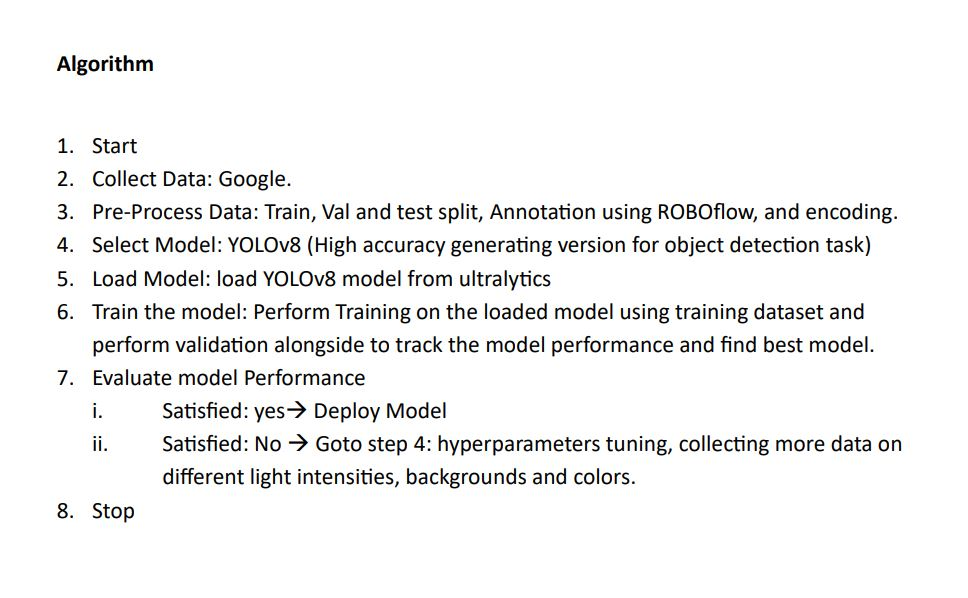

# Face Mask Detection using YOLOv8


A real-time object detection system that finds faces in images, video, or a webcam feed and labels each one as **wearing a mask**, **not wearing a mask**, or **wearing a mask incorrectly**. It is built by fine-tuning the lightweight **YOLOv8n** model from [Ultralytics](https://github.com/ultralytics/ultralytics) on 853 annotated images.

---

## Table of Contents

- [Features](#features)
- [Classes](#classes)
- [Results](#results)
- [Project Structure](#project-structure)
- [Dataset](#dataset)
- [Methodology](#methodology)
- [Installation](#installation)
- [Usage](#usage)
- [Future Improvements](#future-improvements)
- [Acknowledgements](#acknowledgements)

---

## Features

- Converts Pascal VOC (XML) annotations to YOLO format.
- Splits the data 80/20 into training and validation sets automatically.
- Fine-tunes a pretrained YOLOv8 Nano model (about 3M parameters, 8.1 GFLOPs).
- Runs inference on still images (`.jpg`, `.png`, `.webp`, `.avif`).
- Runs **real-time detection from a webcam** with OpenCV.

## Classes

| ID | Class                   | Description                                        |
|----|-------------------------|----------------------------------------------------|
| 0  | `mask_weared_incorrect` | Mask is worn but doesn't cover the nose or mouth properly |
| 1  | `with_mask`             | Mask is worn correctly                             |
| 2  | `without_mask`          | No mask is worn                                    |

## Results

The model was trained for **50 epochs** at an image size of **416** with a batch size of **16**. The table below shows validation results for the best checkpoint (171 images, 758 labeled faces):

| Class                   | Images | Instances | Precision | Recall | mAP@50 | mAP@50-95 |
|-------------------------|:------:|:---------:|:---------:|:------:|:------:|:---------:|
| **All**                 | 171    | 758       | **0.866** | **0.690** | **0.788** | **0.531** |
| `with_mask`             | 158    | 625       | 0.936     | 0.866  | 0.918  | 0.645     |
| `without_mask`          | 55     | 119       | 0.864     | 0.641  | 0.765  | 0.498     |
| `mask_weared_incorrect` | 10     | 14        | 0.798     | 0.564  | 0.680  | 0.449     |

**Inference speed:** about 22 ms per image on CPU (AMD EPYC, Ultralytics 8.3.241, PyTorch 2.9).

> The `mask_weared_incorrect` class has the lowest scores. It has only a small number of training examples (see [Future Improvements](#future-improvements)).

## Project Structure

```
faceMaskDetection-using-YOLOv8/
├── annotations/             # 853 Pascal VOC XML annotation files
├── images/                  # 853 source images (.png)
├── outputs/
│   ├── data.yaml            # YOLO dataset config (paths + class names)
│   ├── images/
│   │   ├── train/           # 682 training images
│   │   ├── val/             # 171 validation images
│   │   └── test/            # Sample images for inference
│   └── labels/
│       ├── train/           # YOLO-format .txt labels
│       └── val/
├── runs/detect/             # Ultralytics training runs (args, metrics, weights)
│   └── train/weights/best.pt  # Best trained model
├── program.ipynb            # End-to-end pipeline: preprocessing → training → inference
├── yolov8n.pt               # Pretrained YOLOv8 Nano base weights
├── algorithm.jpeg           # Project workflow diagram
└── Presentation.pptx        # Project presentation slides
```

## Dataset

- **Source:** Images collected from Google and Kaggle.
- **Size:** 853 images with 4,072 labeled faces: 3,232 `with_mask`, 717 `without_mask`, and 123 `mask_weared_incorrect`.
- **Annotation format:** Pascal VOC XML. Each file stores the image size and a list of objects with `name` and `bndbox` (`xmin`, `ymin`, `xmax`, `ymax`).
- **Split:** 80% training (682 images) and 20% validation (171 images).

Example annotation (`annotations/maksssksksss0.xml`):

```xml
<object>
    <name>with_mask</name>
    <bndbox>
        <xmin>185</xmin><ymin>100</ymin>
        <xmax>226</xmax><ymax>144</ymax>
    </bndbox>
</object>
```

The XML files are converted to YOLO format, with one `.txt` file per image and one line per object:

```
<class_id> <x_center> <y_center> <width> <height>    # all values normalized to [0, 1]
```

## Methodology



1. **Data collection:** Gather face images from Google and Kaggle that show people with and without masks.
2. **Preprocessing:** Parse the XML annotations, encode the class labels with `LabelEncoder`, convert the bounding boxes to normalized YOLO format, split into train and validation sets, and generate `data.yaml`.
3. **Model selection:** Use YOLOv8, a single-stage detector that is both accurate and fast.
4. **Model loading:** Load the pretrained `yolov8n.pt` weights through the `ultralytics` library.
5. **Training:** Fine-tune on the training set and validate after each epoch to keep the best checkpoint.
6. **Evaluation:** Review precision, recall, and mAP. If the results are good enough, deploy the model. Otherwise, tune the hyperparameters or collect more varied data (lighting, backgrounds, skin tones) and train again.

## Installation

### Prerequisites

- Python 3.10 or later
- (Optional) A CUDA-capable GPU for faster training
- A webcam, for real-time detection

### Setup

```bash
# Clone the repository
git clone https://github.com/ashoktamang002/faceMaskDetection-using-YOLOv8.git
cd faceMaskDetection-using-YOLOv8

# Create and activate a virtual environment
python -m venv venv
source venv/bin/activate        # Windows: venv\Scripts\activate

# Install dependencies
pip install ultralytics opencv-python scikit-learn matplotlib jupyter
```

## Usage

> **Note:** The notebook and `outputs/data.yaml` contain absolute paths from the original environment (Google Colab or Windows). Change `ANNOTATIONS_DIR`, `IMAGES_DIR`, the paths in `data.yaml`, and `model_weights_path` to match your machine before you run anything.

### 1. Run the full pipeline

```bash
jupyter notebook program.ipynb
```

Run the cells in order. They preprocess the data, train the model, and display predictions.

### 2. Train from the command line

```bash
yolo detect train data=outputs/data.yaml model=yolov8n.pt epochs=50 imgsz=416 batch=16
```

### 3. Detect masks in images

```python
from ultralytics import YOLO

model = YOLO("runs/detect/train/weights/best.pt")
results = model.predict("outputs/images/test/1.jpg", save=True, conf=0.25)
```

Or from the CLI:

```bash
yolo detect predict model=runs/detect/train/weights/best.pt source=outputs/images/test
```

### 4. Real-time webcam detection

```python
import cv2
from ultralytics import YOLO

model = YOLO("runs/detect/train/weights/best.pt")
cap = cv2.VideoCapture(0)

while True:
    ret, frame = cap.read()
    if not ret:
        break
    annotated = model(frame, verbose=False)[0].plot()
    cv2.imshow("Face Mask Detection", annotated)
    if cv2.waitKey(1) & 0xFF == ord("q"):   # Press 'q' to quit
        break

cap.release()
cv2.destroyAllWindows()
```

## Future Improvements

- **Fix the class imbalance:** `mask_weared_incorrect` has far fewer samples than the other classes. Possible fixes are collecting more examples, oversampling, or class-weighted loss.
- **Improve recall:** Train for more epochs, use a larger input size (e.g. 640), or try a larger model (`yolov8s`/`yolov8m`).
- **Add a held-out test split** so the final evaluation is unbiased.
- **Increase data diversity:** Add images with different lighting, backgrounds, and skin tones, and with more occlusion.
- **Deploy:** Export to ONNX or TensorRT, or wrap the model in a Streamlit/Flask web app.
- **Make paths portable:** Use relative or configurable paths instead of hard-coded ones.

## Acknowledgements

- [Ultralytics YOLOv8](https://github.com/ultralytics/ultralytics) for the detection framework and pretrained weights.
- [OpenCV](https://opencv.org/) for image and video processing.
- [Kaggle](https://www.kaggle.com/) and Google Images for the face mask images used in training.

---

<p align="center">Made by <a href="https://github.com/ashoktamang002">Ashok Tamang</a></p>
